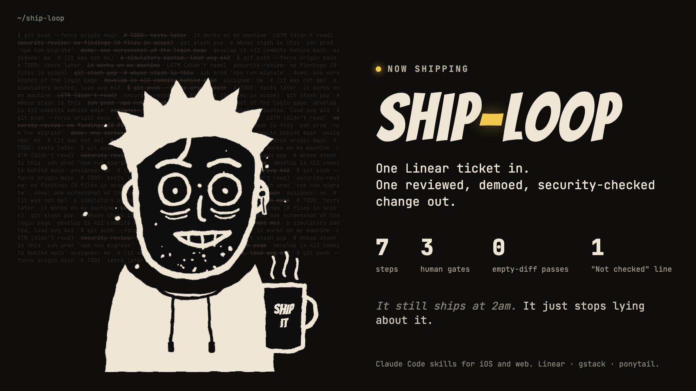
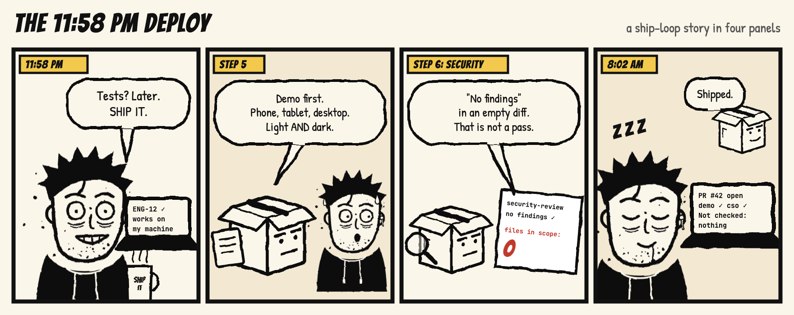

<p align="center">
  <picture>
    <source media="(prefers-color-scheme: dark)" srcset="assets/logo-dark.png">
    
  </picture>
</p>

<h1 align="center">ship-loop</h1>

<p align="center">
  <em>It still ships at 2am. It just stops lying about it.</em>
</p>

<p align="center">
  
  
  
  
</p>

<p align="center">
  
</p>

---

You know the type. Hoodie. Three all-nighters deep. Fourth coffee in a mug that says
SHIP IT. Pushes at 11:58 PM because "it works on my machine."

ship-loop puts a deadpan cardboard box between that founder and `main`.

<p align="center">
  
</p>

## What it does

**One Linear ticket in, one reviewed, demoed, security-checked change out.**

`ship-loop` is a pair of Claude Code skills that take a Linear ticket from "ready" to
landed. They stop for a human only where a human decision matters:

```
/ship-loop-ios ENG-12        # iOS, React Native or Expo app
/ship-loop-web ENG-12 ENG-14 # web app, two tickets in parallel
```

| Step | What happens | Stops for you? |
| --- | --- | --- |
| 1 | New worktree off your base branch, related-ticket check, assign + In Progress | if a related ticket is unfinished |
| 2 | Design demo with `impeccable` (web: responsive HTML + dark toggle; iOS: simulator captures) | approve the design |
| 3 | `/plan-eng-review` + `/plan-design-review` | — |
| 4 | Implement with `ponytail`, tests for new logic, project checks, `/ponytail-review`, impeccable on changed UI (web: `detect`, iOS: native `audit`) | — |
| 5 | MP4 demo of every changed state, light + dark, attached to the ticket | approve the demo |
| 6 | `/cso` + `security-review` with a non-empty-diff check, rebase, PR or merge, Linear status | only on findings or a risky conflict |
| 7 | Remove the worktree | yes/no |

Every run ends with a fixed report, including a required **Not checked:** line.

## Why it exists

It encodes rules learned from real runs that went wrong:

- **Tickets go to the right person.** The assignee comes from a local config slot, not
  from Linear's `me` (which resolves to whoever the MCP is signed in as) or from git
  identity (which often matches no Linear account). See [Assignee](#assignee).
- **No false passes.** In a worktree, `security-review` can review an empty diff and
  report "no findings". The loop checks the review's scope before it accepts a pass.
- **No stale base branch.** The base branch comes from config, never a guess. A branch
  cut from a dead `develop` once cost a full rebase.
- **No shared-stash accidents.** All worktrees share one stash list, so the loop never
  uses `git stash`.
- **No meltdowns in parallel runs.** Batches share one simulator and one dev-server port
  per ticket. Six booted simulators once pushed load average to 642.
- **Small diffs.** Implementation runs under [ponytail](https://github.com/DietrichGebert/ponytail),
  which writes the smallest complete change and never cuts tests, validation or security.
- **No default-looking UI.** New UI is designed with [impeccable](https://impeccable.style),
  and impeccable checks every changed screen before the demo.

## Install

Check [INSTALL.md](INSTALL.md) for prerequisites first. Then:

```bash
git clone https://github.com/sid0913/ship-loop.git ~/ship-loop
cd ~/ship-loop
./install.sh                                   # links both skills into ~/.claude/skills
bin/ship-loop-assignee "Your Linear name"      # who your tickets go to
./install.sh --project ~/code/my-app ios       # optional: copy into a repo for teammates
```

`./install.sh --check` lists what is missing.

## Configure a project

Each repo has a committed `.claude/ship-loop.json`. `./install.sh --project` writes a
starter from [`examples/`](examples):

```json
{
  "base_branch": "main",
  "land_mode": "pr",
  "checks": ["npm run typecheck", "npm test", "npm run build"],
  "web": { "dev_command": "npm run dev", "port": 3000 }
}
```

| Key | Meaning |
| --- | --- |
| `base_branch` | Branch to cut from and land on. |
| `land_mode` | `pr`: push the branch, open a PR, ticket goes to In Review. Use this if your host deploys only on PR merge. `merge`: merge and push the base branch, ticket goes to Done. |
| `checks` | Commands that must pass in Step 4 and again after the rebase. |
| `ios.workspace`, `ios.scheme`, `ios.bundle_id` | Used to build, launch and point the app at Metro. |
| `ios.devices` | Simulator devices to record on. List only the device families you ship. |
| `web.dev_command`, `web.port` | Dev server. In a batch, each ticket uses `port + ticket number`. |

## Assignee

Each person has a slot that holds their Linear name. The slot is never committed:

| File | Scope |
| --- | --- |
| `.claude/ship-loop.local.json` | this repo only (gitignored) |
| `~/.config/ship-loop/config.json` | every repo |

```bash
bin/ship-loop-assignee "Ada Lovelace"             # every repo
bin/ship-loop-assignee --project . "Ada Lovelace" # this repo, and gitignore it
bin/ship-loop-assignee --show                     # what a run here would use
```

The skill checks the stored name against Linear's member list before it assigns. If the
slot is empty or matches no one, it asks once and saves the answer.

## Lanes

Small tickets with no UI and no risky surface (auth, payments, data writes, migrations,
native config) can use the **fast lane**: no design step, no plan reviews, and a lighter
demo. Steps 1, 4, 6 and 7 and every gate still run. Add `--fast` to ask for it; the skill
still decides whether the ticket qualifies.

## Layout

```
skills/ship-loop-ios/   SKILL.md + references/simulator-runbook.md
skills/ship-loop-web/   SKILL.md + references/browser-demo-runbook.md
examples/               starter project and assignee configs
bin/ship-loop-assignee  set or show the assignee slot
install.sh              link, copy into a project, check prereqs, uninstall
tests/run.sh            checks for drift and known mistakes
assets/                 README art; assets/src/ redraws it (open in a browser, screenshot)
```

## Tests

```bash
tests/run.sh
```

The tests check that steps and list items are numbered without gaps, that both skills
share an identical assignee section, and that no skill assigns to `me`, contains a
personal email, or hardcodes a Linear MCP prefix. They also check that Step 2 designs with
impeccable, that Step 4 requires ponytail, tests and an impeccable check, that the security gate checks the diff scope, that the final report
has **Not checked**, and that every link resolves. Finally, they run the installer and the
assignee script against a throwaway `HOME`.

## License

MIT. Ship it. After the demo.
